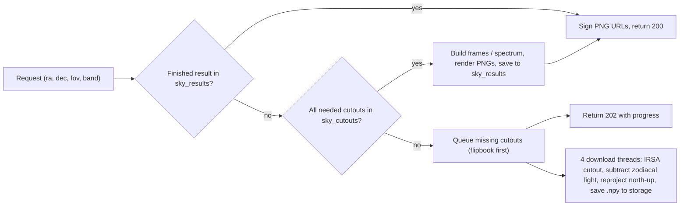

# SkyFlip Backend API Reference

The SkyFlip backend is a FastAPI app (`backend/main.py`, API version **2.0.0**). It serves real NASA SPHEREx pictures and spectra from NASA/IPAC IRSA, Gaia DR3 / AllWISE catalogue overlays, and the citizen-science data (flags, votes, saved projects) stored in Supabase.

This document covers every endpoint as it is implemented now. If the code and this file disagree, the code is right: please fix this file in the same commit.

---

## Contents

1. [Getting started](#1-getting-started)
2. [General conventions](#2-general-conventions)
3. [The 202 "still downloading" pattern](#3-the-202-still-downloading-pattern)
4. [Endpoint summary](#4-endpoint-summary)
5. [Service endpoints](#5-service-endpoints) — health, bands
6. [Sky picture endpoints](#6-sky-picture-endpoints) — sky-cutout, difference-image, shift-and-add, spectrum
7. [Catalogue and coordinate endpoints](#7-catalogue-and-coordinate-endpoints) — catalog-overlay, pixel-to-radec
8. [Candidate (flag) endpoints](#8-candidate-flag-endpoints)
9. [Project endpoints](#9-project-endpoints)
10. [Frontend static serving](#10-frontend-static-serving)
11. [Reference tables](#11-reference-tables) — band groups, stretches, colormaps, filters, categories
12. [Caching and performance](#12-caching-and-performance)
13. [Worked examples](#13-worked-examples)
14. [Known limitations](#14-known-limitations)

---

## 1. Getting started

### Run the backend

```bash
./start.sh            # backend on :8000 and frontend on :5173 (Windows: .\start.bat)
```

or the backend alone:

```bash
cd backend
PYTHONPATH=. ./venv/bin/uvicorn main:app --host 0.0.0.0 --port 8000 --reload
# Windows: .\venv\Scripts\python.exe -m uvicorn main:app --host 0.0.0.0 --port 8000
```

`backend/.env` must contain `SUPABASE_URL` and `SUPABASE_SECRET_KEY` (copy `backend/.env.example`). Without them every endpoint that touches the cache or the database fails. Never commit or print that file.

> `./start.sh` runs the backend without auto-reload. After changing backend code, restart it and check `/api/health`.

### Check it is up

```bash
curl -s http://localhost:8000/api/health
# {"status":"ok","service":"NASA SPHEREx Sky Viewer API","version":"2.0.0"}
```

### Interactive docs

FastAPI generates these automatically from the code:

| URL | What |
|---|---|
| `http://localhost:8000/docs` | Swagger UI (try requests in the browser) |
| `http://localhost:8000/redoc` | ReDoc |
| `http://localhost:8000/openapi.json` | OpenAPI 3 schema (for client generators) |

### Base URL

- Direct: `http://localhost:8000`
- From the frontend dev server: relative `/api/...`. Vite (`frontend/vite.config.js`) proxies `/api` to `localhost:8000`.

---

## 2. General conventions

| Topic | Behaviour |
|---|---|
| Format | JSON in and out, except `/api/candidates/export-mpc` (plain text) and the static frontend routes. |
| Authentication | **None.** There is no login (issue #6). Anyone who can reach the server can create, vote on, edit and delete everything. |
| CORS | All origins, methods and headers are allowed. |
| Coordinates | Sky endpoints take `ra`/`dec` as **strings**: decimal degrees (`133.795129`, `-7.245147`) or sexagesimal (`08h55m10.831s`, `-07d14m42.53s`, or `08:55:10.83` / `-07:14:42.5`; colon or space form is read as hours for RA and degrees for Dec). Candidate cone search and project/candidate bodies use **decimal degrees as numbers**. Frame is ICRS (J2000). |
| Field of view | `fov` is in **arcminutes**, default `5.0`. The viewer offers 1–30′. |
| Pixel grid | All rendered pictures are **256 × 256**, north up, east left. `pixel_x` grows to the right (west), `pixel_y` grows downward (south). Catalogue positions, flag positions and shift-and-add shifts all use this grid. |
| Dates | Survey visit dates are `YYYY-MM-DD`; `mjd` is Modified Julian Date. Database timestamps are ISO 8601 UTC. |

### Status codes

| Code | Meaning |
|---|---|
| `200` | Success. |
| `201` | Created (`POST /api/candidates`, `POST /api/projects`). |
| `202` | SPHEREx images are still downloading. Ask again later (see [section 3](#3-the-202-still-downloading-pattern)). |
| `400` | Bad input: coordinates that can't be parsed, unknown `band_group`, same early/late visit, or a database constraint failure (bad category, confidence outside 1–5, RA outside 0–360, ...). |
| `404` | Not found: unknown candidate/project id, unknown `/api/...` path, or SPHEREx has no images of that spot/band. |
| `422` | Request validation failed (FastAPI): missing required parameter, wrong type, `voter_id` empty or over 100 characters. |
| `500` | Database query failed (candidates list, projects list, MPC export). |
| `502` | IRSA (NASA's archive) could not be reached or returned an error. |

Error bodies follow FastAPI's format:

```json
{ "detail": "Candidate 42 not found" }
```

`422` errors have `detail` as a list of validation problems:

```json
{ "detail": [ { "type": "missing", "loc": ["query", "ra"], "msg": "Field required", "input": null } ] }
```

There are **no made-up fallbacks**: if IRSA or Supabase fails, you get an error, never placeholder data.

---

## 3. The 202 "still downloading" pattern

The first time anyone asks for a sky position, the backend has to download SPHEREx cutouts from IRSA (about 10–15 s each, 4 at a time). Instead of making you wait on one long request, these endpoints answer **202 Accepted** right away and keep downloading in the background:

- `GET /api/sky-cutout`
- `GET /api/difference-image`
- `GET /api/shift-and-add`
- `GET /api/spectrum`

202 body:

```json
{
  "status": "downloading",
  "cached_images": 7,
  "total_images": 24,
  "message": "Downloading SPHEREx images from NASA/IPAC IRSA: 7 of 24 ready."
}
```

`total_images` is the number of images **this request** needs, not every image of the spot.

**How to use it:** repeat the identical request every few seconds until the status is no longer 202. The frontend polls every 3 s (`poll()` in `frontend/src/services/api.js`).

```js
async function poll(url, onProgress) {
  for (;;) {
    const res = await fetch(url);
    const body = await res.json();
    if (res.status !== 202) {
      if (!res.ok) throw new Error(body.detail);
      return body;
    }
    onProgress?.(body.cached_images, body.total_images);
    await new Promise((r) => setTimeout(r, 3000));
  }
}
```

```bash
# shell version
until [ "$(curl -s -o out.json -w '%{http_code}' "$URL")" != "202" ]; do sleep 3; done; cat out.json
```

Typical first-time waits:

| Request | Images needed | First time |
|---|---|---|
| One detector (`array_1`..`array_6`), 4 visits | up to 4 | under a minute |
| `stacked` or `false_color_rgb`, 4 visits | up to 24 | a few minutes |
| Spectrum, narrow-band filter, ratio or index | every image of the spot (~260) | 10–15+ minutes |

Flipbook downloads always jump ahead of spectrum/filter downloads in the queue. Images that fail after all retries are skipped, so one bad image can't block a request forever. Once cached, repeat requests return in well under a second.

---

## 4. Endpoint summary

| Method | Path | Purpose | Can return 202 |
|---|---|---|---|
| GET | `/api/health` | Service check | |
| GET | `/api/bands` | Detector layout and every accepted `band_group` | |
| GET | `/api/sky-cutout` | Flipbook frames (one per visit) + difference images | ✓ |
| GET | `/api/difference-image` | Difference between two chosen visits | ✓ |
| GET | `/api/shift-and-add` | Co-add visits along a trial motion | ✓ |
| GET | `/api/spectrum` | 102-channel spectrum of the centre position | ✓ |
| GET | `/api/catalog-overlay` | Gaia DR3 + AllWISE sources in the field | |
| GET | `/api/pixel-to-radec` | 256-grid pixel → RA/Dec | |
| GET | `/api/candidates` | List flags (filters, cone search) | |
| POST | `/api/candidates` | Create a flag | |
| GET | `/api/candidates/export-mpc` | Plain-text MPC-style dossier | |
| GET | `/api/candidates/{id}` | One flag with its votes | |
| POST | `/api/candidates/{id}/vote` | Vote / take a vote back | |
| DELETE | `/api/candidates/{id}` | Delete a flag | |
| GET | `/api/projects` | List saved projects | |
| POST | `/api/projects` | Create a project | |
| PATCH | `/api/projects/{id}` | Update a project | |
| DELETE | `/api/projects/{id}` | Delete a project | |

---

## 5. Service endpoints

### `GET /api/health`

```bash
curl -s localhost:8000/api/health
```

```json
{ "status": "ok", "service": "NASA SPHEREx Sky Viewer API", "version": "2.0.0" }
```

This only shows the process is up. It does not check IRSA or Supabase.

### `GET /api/bands`

SPHEREx's six detector arrays and every `band_group` the sky endpoints accept. No parameters, no network calls.

```json
{
  "mission": "NASA SPHEREx",
  "total_bands": 102,
  "wavelength_range_um": [0.75, 5.0],
  "detector_arrays": {
    "array_1": { "name": "Array 1 (Near-IR 1)", "range_um": [0.75, 1.11], "bands": 17, "index": 1 },
    "...": "array_2 .. array_6"
  },
  "wavelength_filters": {
    "stacked": {
      "name": "All 6 Detectors Stacked (High SNR)",
      "category": "composite",
      "wavelength_um": "0.75 - 5.00",
      "description": "Combines one image from each of the 6 detector arrays per visit ..."
    },
    "filter_ch4_deep": {
      "name": "🪐 CH₄ Methane Filter (3.30 μm)",
      "category": "diagnostic",
      "wavelength_um": 3.3,
      "element": "CH4",
      "description": "..."
    },
    "ratio_ch4": { "name": "...", "category": "index", "ratio": [3.3, 2.15], "description": "..." },
    "diff_hydrogen": { "name": "...", "category": "index", "difference": [4.05, 3.82], "description": "..." }
  }
}
```

The keys of `wavelength_filters` are the valid `band_group` values. Full list in [section 11](#band-groups).

---

## 6. Sky picture endpoints

All four share the position parameters:

| Param | Type | Default | Notes |
|---|---|---|---|
| `ra` | string | required | Decimal degrees or sexagesimal |
| `dec` | string | required | Decimal degrees or sexagesimal |
| `fov` | float | `5.0` | Arcminutes |

Positions within half a SPHEREx pixel (about 3″) of a cached position reuse its cache.

### `GET /api/sky-cutout`

Real SPHEREx pictures of a position, one per survey visit (oldest first), plus difference images between every pair of visits. This is the main flipbook endpoint.

| Param | Type | Default | Notes |
|---|---|---|---|
| `band_group` | string | `stacked` | Any key from `/api/bands` |
| `stretch` | string | `zscale` | `zscale`, `asinh`, `linear`, `log` |
| `colormap` | string | `inferno` | `inferno`, `viridis`, `magma`, `grayscale` (others: any matplotlib name; unknown falls back to `inferno`) |
| `epochs` | int | `4` | Number of most recent survey visits to return (minimum 1) |

```bash
curl -s "localhost:8000/api/sky-cutout?ra=133.795129&dec=-7.245147&fov=5&band_group=array_6&colormap=grayscale"
```

200 response:

```json
{
  "target_info": {
    "ra_deg": 133.795129,
    "dec_deg": -7.245147,
    "ra_hms": "08h55m10.831s",
    "dec_dms": "-07d14m42.53s",
    "fov_arcmin": 5.0,
    "band_group": "array_6",
    "active_filter_meta": { "name": "Array 6: 4.42 - 5.00 μm", "category": "detector", "...": "..." },
    "stretch": "zscale",
    "colormap": "grayscale"
  },
  "epochs": [
    {
      "epoch_index": 0,
      "timestamp": "2025-05-06",
      "mjd": 60801.43,
      "images_used": 1,
      "irsa_uris": ["ibe/data/spherex/..."],
      "image_url": "https://<supabase>/storage/v1/object/sign/sky-cutouts/results/<key>/0.png?token=..."
    }
  ],
  "difference_image_url": "https://.../diff_0_3.png?token=...",
  "difference_images": {
    "0_1": "https://.../diff_0_1.png?token=...",
    "0_2": "...", "0_3": "...", "1_2": "...", "1_3": "...", "2_3": "..."
  },
  "source": { "mission": "SPHEREx", "archive": "NASA/IPAC IRSA", "total_images_at_position": 262 },
  "spherex_detector_arrays": { "...": "same as /api/bands detector_arrays" },
  "available_filters": { "...": "same as /api/bands wavelength_filters" }
}
```

Field notes:

- `epochs[].image_url` — a 256 × 256 PNG in a private Supabase bucket. **Signed URLs expire after 6 hours**; request again for fresh ones.
- `images_used` / `irsa_uris` — the SPHEREx exposures combined into that frame (one per detector for `stacked`; for filters, every exposure whose wavelength at this spot is within ±2% of the target).
- `difference_images` — keys are `"a_b"` (epoch indices, `a < b`), value is the picture of visit **b minus visit a**. Red = brighter/appeared, blue = fainter/disappeared (coolwarm colormap, zero = neutral). A moving object shows as a blue–red pair.
- `difference_image_url` — first visit vs last visit (`"0_<n-1>"`), or `null` if there is only one visit.
- For `false_color_rgb`, no difference images are made (both difference fields are `null`/empty) and `colormap` is ignored: blue = arrays 1–2, green = arrays 3–4, red = arrays 5–6.
- In `stacked`, each detector is background-subtracted and scaled by its noise before averaging, so pixel values are not physical units.

Errors: `400` unknown `band_group` / bad coordinates; `404` SPHEREx has no images of this spot (or none in that band); `502` IRSA failure.

### `GET /api/difference-image`

The difference between two specific visits (late minus early). `/api/sky-cutout` already returns every pair, so this endpoint is only needed for a specific stretch/colormap or a standalone request.

| Param | Type | Default | Notes |
|---|---|---|---|
| `band_group` | string | `stacked` | Not `false_color_rgb` |
| `early_idx` | int | `0` | Reference visit |
| `late_idx` | int | `1` | Comparison visit |
| `stretch` | string | `zscale` | Accepted, but difference pictures always use the symmetric coolwarm scale |
| `colormap` | string | `inferno` | Accepted, same note |

Indices refer to the **4 most recent visits** (0 = oldest of those) and are clamped to the valid range. `early_idx` may be larger than `late_idx` (you get the reverse difference).

```bash
curl -s "localhost:8000/api/difference-image?ra=133.795129&dec=-7.245147&band_group=array_6&early_idx=0&late_idx=3"
```

```json
{
  "early_epoch": { "index": 0, "timestamp": "2025-05-06", "mjd": 60801.43 },
  "late_epoch":  { "index": 3, "timestamp": "2026-04-28", "mjd": 61158.12 },
  "difference_image_url": "https://.../diff_0_3.png?token=...",
  "pair": "0_3",
  "band_group": "array_6",
  "fov_arcmin": 5.0
}
```

Errors: `400` if both indices end up equal after clamping; `404` if fewer than 2 visits or `false_color_rgb`.

### `GET /api/shift-and-add`

Searches for faint moving objects. It slides each visit by `i × (shift_x, shift_y)` (visit `i` counted from the oldest) and takes the median. Stars smear out; something moving at that rate lines up and gets brighter. Uses **every** visit of the spot, not just the last 4.

| Param | Type | Default | Notes |
|---|---|---|---|
| `shift_x` | float | `0.0` | Display pixels per visit (256 grid), + = right |
| `shift_y` | float | `0.0` | Display pixels per visit, + = down |
| `band_group` | string | `stacked` | Not `false_color_rgb` |
| `stretch` | string | `zscale` | |
| `colormap` | string | `inferno` | |
| `filter_mode` | string | `normal` | `normal`, `smooth` (Gaussian σ=1), `sharpen` (unsharp mask), `median` (3×3), `threshold_3sigma` (keep pixels above median + 2.5σ) |

```bash
curl -s "localhost:8000/api/shift-and-add?ra=133.795129&dec=-7.245147&band_group=array_6&shift_x=4&shift_y=-2"
```

```json
{
  "shift_x": 4.0,
  "shift_y": -2.0,
  "filter_mode": "normal",
  "image_url": "data:image/png;base64,iVBORw0KGgo...",
  "epochs_stacked": 4,
  "snr_boost": "2.0x (sqrt(4) visits co-added)",
  "visit_dates": ["2025-05-06", "2025-10-30", "2025-12-14", "2026-04-28"]
}
```

`image_url` is an inline data URI (use it directly as an ``); it is not stored. The result is computed on every call, but the underlying cutouts are cached.

Errors: `400` for `false_color_rgb` or unknown `band_group`; `404` no images in that band.

### `GET /api/spectrum`

A quick-look 102-channel spectrum of the **centre pixel** of the position, built from every SPHEREx image of it. Each SPHEREx exposure sees a given spot at one wavelength, so the spectrum needs every exposure: the first request can report 202 progress for 15 minutes or more.

Only `ra`, `dec`, `fov` are accepted. Because only the centre pixel is measured, any `fov` at the same position returns the same spectrum (it is shared once one exists).

```bash
curl -s "localhost:8000/api/spectrum?ra=133.795129&dec=-7.245147"
```

```json
{
  "target_info": { "ra_deg": 133.795129, "dec_deg": -7.245147, "ra_hms": "08h55m10.831s", "dec_dms": "-07d14m42.53s" },
  "unit": "MJy/sr",
  "method": "Centre-pixel surface brightness (zodiacal light removed) of every SPHEREx image of this position, median per channel. A quick-look spectrum, not calibrated photometry.",
  "channels": [
    { "channel": 1, "detector": 1, "wavelength_um": 0.7533, "flux_mjy_sr": 0.0123, "n_measurements": 3 },
    { "channel": 2, "detector": 1, "wavelength_um": 0.7661, "flux_mjy_sr": null, "n_measurements": 0 }
  ],
  "measurements": [
    { "wavelength_um": 0.7541, "flux_mjy_sr": 0.0119, "detector": 1, "date": "2025-05-06" }
  ]
}
```

- `channels` — always 102 entries (17 per detector). Channel centre wavelengths come from IRSA's DR1 all-sky cube. `flux_mjy_sr` is the median of the measurements binned into that channel, or `null` if none.
- `measurements` — every individual exposure, sorted by wavelength, for plotting the raw scatter.

---

## 7. Catalogue and coordinate endpoints

### `GET /api/catalog-overlay`

Known stars and infrared sources in the field from Gaia DR3 and AllWISE (queried live through IRSA TAP), already projected onto the 256 × 256 picture grid. Never returns 202, but a first query takes **about 30 seconds**. Results are then cached in memory until the backend restarts.

| Param | Type | Default | Notes |
|---|---|---|---|
| `ra`, `dec` | string | required | |
| `fov` | float | `5.0` | |
| `catalogs` | string | `gaia_dr3,allwise` | Comma-separated. Recognised: `gaia_dr3`, `allwise`. Others are ignored. |

Up to 500 sources per catalogue (brightest first); only sources inside the square field are returned.

```bash
curl -s "localhost:8000/api/catalog-overlay?ra=133.795129&dec=-7.245147&fov=5"
```

```json
{
  "target": { "ra_deg": 133.795129, "dec_deg": -7.245147, "ra_hms": "08h55m10.831s", "dec_dms": "-07d14m42.53s", "frame": "icrs" },
  "fov_arcmin": 5.0,
  "total_sources": 57,
  "sources": [
    {
      "id": "Gaia DR3 5761234567890123456",
      "catalog": "Gaia DR3",
      "ra_deg": 133.79123, "dec_deg": -7.24011,
      "pixel_x": 145.3, "pixel_y": 112.1,
      "mag": 14.21, "mag_band": "G (optical)",
      "proper_motion_mas_yr": 12.4,
      "parallax_mas": 1.03,
      "ruwe": 0.98,
      "is_contaminated": false,
      "contamination_note": "Clean astrometry (RUWE 0.98)",
      "is_high_proper_motion": false,
      "is_brown_dwarf_candidate": false
    },
    {
      "id": "AllWISE J085510.83-071442.5",
      "catalog": "AllWISE",
      "ra_deg": 133.795, "dec_deg": -7.2452,
      "pixel_x": 128.0, "pixel_y": 128.0,
      "mag": 17.3, "mag_band": "W1 (3.4 μm)",
      "w1_w2_color": 3.6,
      "cc_flags": "0000", "ph_qual": "UAU", "ext_flg": 0,
      "is_contaminated": false,
      "contamination_note": "Clean (0000 — no known artifacts)",
      "proper_motion_mas_yr": null,
      "is_high_proper_motion": false,
      "is_brown_dwarf_candidate": true
    }
  ]
}
```

Flag meanings:

| Field | Rule |
|---|---|
| `is_high_proper_motion` | Gaia total proper motion > 100 mas/yr |
| `is_contaminated` (Gaia) | RUWE ≥ 1.4 (crowded or unresolved binary) |
| `is_contaminated` (AllWISE) | Any non-zero `cc_flags` character in W1 or W2 |
| `cc_flags` letters | `D` diffraction spike, `P` persistence, `H` scattered-light halo, `O` optical ghost |
| `is_brown_dwarf_candidate` | AllWISE W1 − W2 ≥ 1.0 and no Gaia source within 3″ |

Errors: `400` bad coordinates; `502` IRSA unreachable.

### `GET /api/pixel-to-radec`

Turns a point on the 256 × 256 picture grid into sky coordinates. The viewer uses it to save a flag at the spot the user clicked.

| Param | Type | Default | Notes |
|---|---|---|---|
| `pixel_x` | float | required | 0–256, left → right |
| `pixel_y` | float | required | 0–256, top → bottom |
| `center_ra` | string | required | Picture centre RA |
| `center_dec` | string | required | Picture centre Dec |
| `fov` | float | `5.0` | Field of view of the picture, arcmin |

```bash
curl -s "localhost:8000/api/pixel-to-radec?pixel_x=140&pixel_y=100&center_ra=133.795129&center_dec=-7.245147&fov=5"
```

```json
{ "ra_deg": 133.791191, "dec_deg": -7.236032, "ra_hms": "08h55m09.886s", "dec_dms": "-07d14m09.72s", "frame": "icrs" }
```

The centre of the picture is pixel (128, 128). Uses a flat-sky approximation, which is accurate for these small fields. Errors: `400`.

---

## 8. Candidate (flag) endpoints

A candidate is a point someone flagged as possibly interesting. Candidates and votes live in the Supabase tables `candidates` and `candidate_votes`.

### Candidate object

| Field | Type | Notes |
|---|---|---|
| `id` | int | Assigned by the database |
| `ra_deg` | float | 0 ≤ ra < 360 |
| `dec_deg` | float | −90 … 90 |
| `ra_hms`, `dec_dms` | string | Sexagesimal (may be `""`) |
| `pixel_x`, `pixel_y` | float \| null | Where it was clicked on the 256 grid |
| `category` | string | `planet_x`, `brown_dwarf`, `variable_star`, `asteroid` |
| `confidence` | int | 1–5 |
| `notes` | string | |
| `observer_callsign` | string | Display name, default `Citizen Scientist` |
| `band_group` | string | Band it was seen in |
| `epoch_label` | string | Free text, e.g. which visit |
| `created_at` | string | ISO timestamp |
| `upvotes` | int | Number of votes |
| `user_voted` | bool | Only when `voter_id` was given (list) or after voting |
| `user_owned` | bool | `true` when `voter_id` matches the flag creator |
| `distance_arcmin` | float | Only in cone-search results |
| `votes` | array | Only in single-candidate and vote responses |

### `GET /api/candidates`

| Param | Type | Notes |
|---|---|---|
| `category` | string | One of the categories; `all` or omitted = every category |
| `ra`, `dec`, `radius_deg` | float | Cone search in **decimal degrees**. Applied only when all three are given. Adds `distance_arcmin`. |
| `voter_id` | string | Adds `user_voted` and `user_owned` to each candidate for this browser/voter |

Sorted by `upvotes` (most first), then newest first.

```bash
curl -s "localhost:8000/api/candidates?ra=133.795&dec=-7.245&radius_deg=0.0625&voter_id=3f2b..."
```

```json
[
  {
    "id": 12, "ra_deg": 133.7951, "dec_deg": -7.2451,
    "ra_hms": "08h55m10.82s", "dec_dms": "-07d14m42.4s",
    "pixel_x": 128.4, "pixel_y": 127.9,
    "category": "brown_dwarf", "confidence": 5,
    "notes": "Red dipole in the difference image",
    "observer_callsign": "Citizen Scientist",
    "band_group": "array_6", "epoch_label": "V1 → V4",
    "created_at": "2026-11-14T03:12:44.123+00:00",
    "upvotes": 3, "user_voted": true, "user_owned": false, "distance_arcmin": 0.01
  }
]
```

The viewer uses `radius_deg = fov / 60 × 0.75`.

### `POST /api/candidates` → 201

Body (only `ra_deg` and `dec_deg` are required):

```json
{
  "ra_deg": 133.7951,
  "dec_deg": -7.2451,
  "ra_hms": "08h55m10.82s",
  "dec_dms": "-07d14m42.4s",
  "pixel_x": 128.4,
  "pixel_y": 127.9,
  "category": "brown_dwarf",
  "confidence": 5,
  "notes": "Red dipole in the difference image",
  "observer_callsign": "Citizen Scientist",
  "band_group": "array_6",
  "epoch_label": "V1 → V4",
  "voter_id": "3f2b9c1e-..."
}
```

Defaults: `category` `planet_x`, `confidence` 4, `observer_callsign` `Citizen Scientist`, `band_group` `stacked`, strings `""`. When `voter_id` (1–100 chars) is included, the browser is recorded as the owner (`user_owned: true` on return) and only that `voter_id` can later delete the flag; `voter_id` is never exposed in public candidate responses. Returns the created candidate with `upvotes: 0`.

The backend does not fill in `ra_hms`/`dec_dms` for you. The usual flow is: call `/api/pixel-to-radec` with the clicked pixel, then post its result plus `pixel_x`/`pixel_y`.

Errors: `400` when the database rejects the row (unknown category, confidence outside 1–5, RA/Dec out of range); `422` wrong types or invalid `voter_id`.

### `GET /api/candidates/{id}`

One candidate with every vote (newest first). Accepts optional `?voter_id=...` to populate `user_owned`. `voter_id` is never returned in candidate or vote objects, so nobody can remove someone else's flag or vote.

```json
{
  "id": 12, "...": "candidate fields",
  "upvotes": 2,
  "votes": [
    { "id": 31, "candidate_id": 12, "vote_type": "corroborate", "voter_callsign": "Citizen Scientist", "comment": "", "created_at": "2026-11-14T04:00:00+00:00" }
  ]
}
```

Errors: `404`.

### `POST /api/candidates/{id}/vote`

Votes for a candidate, or takes the vote back. Each `voter_id` counts at most once per candidate (enforced by a unique index); voting again changes nothing.

| Field | Type | Default | Notes |
|---|---|---|---|
| `voter_id` | string | required | 1–100 characters. The frontend uses a random UUID kept in `localStorage` (`skyflip_voter_id`). |
| `vote_type` | string | `corroborate` | `unvote` removes this voter's vote (no error if there was none) |
| `voter_callsign` | string | `Citizen Scientist` | |
| `comment` | string | `""` | |

```bash
curl -s -X POST localhost:8000/api/candidates/12/vote \
  -H "Content-Type: application/json" \
  -d '{"voter_id":"3f2b9c1e-...","vote_type":"corroborate"}'
```

Returns the updated candidate (same shape as `GET /api/candidates/{id}`) plus `user_voted`. Errors: `404`; `422` missing or too-long `voter_id`.

### `DELETE /api/candidates/{id}`

Deletes the candidate and its votes if `?voter_id=...` matches the flag creator (`user_owned: true`).

```bash
curl -s -X DELETE "localhost:8000/api/candidates/12?voter_id=3f2b9c1e-..."
```

```json
{ "status": "deleted", "id": 12 }
```

Errors: `403` when `voter_id` is missing or does not match the flag owner; `404` if not found; `422` invalid `voter_id`.

### `GET /api/candidates/export-mpc`

Every candidate as a fixed-width plain-text dossier in a Minor Planet Center–like layout (`Content-Type: text/plain; charset=utf-8`). It is not a submittable MPC 80-column observation file.

```
COD SPX
OBS NASA SPHEREx Citizen Science Working Group — Space Apps 2026
DAT 2026-11-14 15:20:00 UTC
NUM_CANDIDATES 1
--------------------------------------------------------------------------------
OBJ_ID       RA (J2000)      DEC (J2000)      CONF   VOTES  CATEGORY     OBSERVER
--------------------------------------------------------------------------------
SPX-000012   08 55 10.82     -07 14 42.4      5      3      BROWN_DWAR   Citizen Scienti
--------------------------------------------------------------------------------
END OF SPHEREx CITIZEN SCIENCE DOSSIER
```

---

## 9. Project endpoints

A project is a saved sky position shown as a marker on the Home map. Stored in the Supabase `projects` table and shared by everyone.

### Project object

| Field | Type | Notes |
|---|---|---|
| `id` | int | |
| `name` | string | 1–200 characters, required |
| `description` | string | Default `""` |
| `color` | string | Required; any string (the UI uses hex like `#f07167`) |
| `ra_deg` | float | 0 ≤ ra < 360, required |
| `dec_deg` | float | −90 … 90, required |
| `bands` | int[] | Detector numbers 1–6; default `[1,2,3,4,5,6]` |
| `created_at` | string | |

### `GET /api/projects`

All projects, oldest first. Returns an array of project objects. Errors: `500`.

### `POST /api/projects` → 201

```bash
curl -s -X POST localhost:8000/api/projects -H "Content-Type: application/json" \
  -d '{"name":"WISE 0855","description":"Coldest known brown dwarf","color":"#f07167","ra_deg":133.795129,"dec_deg":-7.245147,"bands":[6]}'
```

Returns the created project. Errors: `400` constraint failure; `422` missing `name`, `color`, `ra_deg` or `dec_deg`.

### `PATCH /api/projects/{id}`

Send only the fields to change. Fields that are omitted or `null` are left as they are (so a field can't be set to null this way). An empty body returns the project unchanged.

```bash
curl -s -X PATCH localhost:8000/api/projects/7 -H "Content-Type: application/json" -d '{"name":"WISE 0855 (renamed)"}'
```

Returns the updated project. Errors: `400`, `404`.

### `DELETE /api/projects/{id}`

```json
{ "status": "deleted", "id": 7 }
```

Errors: `404`. No authentication, same caution as for candidates.

---

## 10. Frontend static serving

When `frontend/dist/` exists (after `npm run build`), the backend also serves the built app:

| Path | Serves |
|---|---|
| `/` | `frontend/dist/index.html`, or `{"message": "NASA SPHEREx Sky Viewer Backend API. Visit /docs ..."}` if there is no build |
| `/assets/*` | Built JS/CSS |
| `/<any other path>` | That file from `dist/` if it exists, else `index.html` (SPA fallback) |
| `/api/<unknown>` | `404 {"detail": "Not Found"}` (never the SPA) |

---

## 11. Reference tables

### Band groups

Every value accepted by `band_group` (the keys of `/api/bands` → `wavelength_filters`).

**Detector groups** — need only one image per detector per visit (fast):

| `band_group` | Images per visit | Notes |
|---|---|---|
| `stacked` | up to 6 | Noise-normalised mean of all six detectors |
| `false_color_rgb` | up to 6 | B = arrays 1–2, G = 3–4, R = 5–6. No difference images, no shift-and-add |
| `array_1` | 1 | 0.75–1.11 µm |
| `array_2` | 1 | 1.11–1.64 µm |
| `array_3` | 1 | 1.64–2.42 µm |
| `array_4` | 1 | 2.42–3.82 µm |
| `array_5` | 1 | 3.82–4.42 µm |
| `array_6` | 1 | 4.42–5.00 µm |

**Wavelength groups** — need every image of the spot (slow the first time). Each frame averages the exposures whose wavelength at that spot is within ±2% of the target; visits with no match are left out.

| `band_group` | Wavelength(s) µm | Category |
|---|---|---|
| `filter_h2o_ice` | 3.05 | diagnostic |
| `filter_h2o_vapor` | 1.90 | diagnostic |
| `filter_ch4_deep` | 3.30 | diagnostic |
| `filter_ch4_overtone` | 1.66 | diagnostic |
| `filter_co2_ice` | 4.25 | diagnostic |
| `filter_co` | 4.60 | diagnostic |
| `filter_h_bra` | 4.05 | diagnostic |
| `filter_pah_dust` | 3.40 | diagnostic |
| `filter_j` | 1.25 | photometric |
| `filter_h` | 1.65 | photometric |
| `filter_ks` | 2.15 | photometric |
| `filter_wise_w1` | 3.40 | photometric |
| `filter_wise_w2` | 4.60 | photometric |
| `ratio_ch4` | 3.30 / 2.15 | index (ratio) |
| `ratio_h2o` | 3.05 / 2.15 | index (ratio) |
| `diff_hydrogen` | 4.05 − 3.82 | index (difference) |

### Stretches

| `stretch` | Effect |
|---|---|
| `zscale` | IRAF/DS9 ZScale limits (contrast 0.25), linear. Best default for faint sources. |
| `asinh` | 1st–99.8th percentile clip, then asinh (a = 0.1). Keeps bright cores. |
| `log` | Percentile clip, then log (a = 1000). |
| `linear` | Percentile clip only. Unknown values behave like this. |

### Colormaps

`inferno` (default), `viridis`, `magma`, `grayscale`. Any matplotlib colormap name also works; unknown names fall back to `inferno`. Difference pictures always use `coolwarm`.

### Candidate categories

`planet_x`, `brown_dwarf`, `variable_star`, `asteroid`.

---

## 12. Caching and performance



- **Position list**: the first request for a new spot asks IRSA's TAP service which SPHEREx DR1/QR3 images cover it (stored in `sky_positions`). Images more than 10 days apart count as different survey visits.
- **Cutouts**: each image is downloaded once, reprojected onto a common north-up grid at the native 6.15″ pixel scale, and saved in the private `sky-cutouts` bucket. A smaller FOV at the same position reuses a larger FOV's cutouts by centre-cropping.
- **Results**: finished sky-cutout and spectrum responses are stored in `sky_results`, keyed by position, band, stretch, colormap and epoch count. Changing any of those builds a new result (fast once the cutouts are cached).
- **Not cached as results**: `/api/difference-image` (renders and uploads a PNG each call) and `/api/shift-and-add` (returns an inline image each call).
- **Catalogue**: in-memory only; lost on restart.
- **IRSA retries**: 429/5xx and dropped connections are retried after 10 s, 30 s and 90 s.
- **Download queue is in memory**: if the backend restarts mid-download, the next request queues the missing images again.

### Positions to test with

| Target | RA | Dec | Cached |
|---|---|---|---|
| WISE 0855 (coldest known brown dwarf) | 133.795129 | −7.245147 | Everything: flipbook, spectrum, filters, catalogue. Loads in under a second. |
| Proxima Centauri | 217.429167 | −62.679444 | Flipbook only |

---

## 13. Worked examples

### Load a flipbook and blink it (JavaScript)

```js
const API = 'http://localhost:8000';

async function poll(url) {
  for (;;) {
    const res = await fetch(url);
    const body = await res.json();
    if (res.status === 202) {
      console.log(`${body.cached_images}/${body.total_images} pictures ready`);
      await new Promise((r) => setTimeout(r, 3000));
      continue;
    }
    if (!res.ok) throw new Error(typeof body.detail === 'string' ? body.detail : JSON.stringify(body.detail));
    return body;
  }
}

const q = new URLSearchParams({ ra: '133.795129', dec: '-7.245147', fov: '5', band_group: 'array_6' });
const sky = await poll(`${API}/api/sky-cutout?${q}`);

const img = document.querySelector('#sky');
let i = 0;
setInterval(() => { img.src = sky.epochs[i++ % sky.epochs.length].image_url; }, 600);
```

### Flag the point a user clicked, then vote for it

```js
const centre = { ra: 133.795129, dec: -7.245147, fov: 5 };
const click = { x: 140, y: 100 };          // on the 256 x 256 picture

const where = await (await fetch(`${API}/api/pixel-to-radec?` + new URLSearchParams({
  pixel_x: click.x, pixel_y: click.y, center_ra: centre.ra, center_dec: centre.dec, fov: centre.fov,
}))).json();

const flag = await (await fetch(`${API}/api/candidates`, {
  method: 'POST',
  headers: { 'Content-Type': 'application/json' },
  body: JSON.stringify({
    ra_deg: where.ra_deg, dec_deg: where.dec_deg, ra_hms: where.ra_hms, dec_dms: where.dec_dms,
    pixel_x: click.x, pixel_y: click.y,
    category: 'asteroid', confidence: 3, notes: 'Moves between visits 2 and 3', band_group: 'array_6',
  }),
})).json();

const voterId = localStorage.getItem('skyflip_voter_id') ?? crypto.randomUUID();
await fetch(`${API}/api/candidates/${flag.id}/vote`, {
  method: 'POST',
  headers: { 'Content-Type': 'application/json' },
  body: JSON.stringify({ voter_id: voterId }),
});
```

### Python: spectrum to CSV

```python
import csv, time, requests

API = "http://localhost:8000"
params = {"ra": "133.795129", "dec": "-7.245147"}

while True:
    r = requests.get(f"{API}/api/spectrum", params=params, timeout=60)
    if r.status_code != 202:
        r.raise_for_status()
        break
    p = r.json()
    print(f"{p['cached_images']}/{p['total_images']} images ready")
    time.sleep(5)

with open("spectrum.csv", "w", newline="") as f:
    w = csv.writer(f)
    w.writerow(["channel", "wavelength_um", "flux_mjy_sr", "n_measurements"])
    for c in r.json()["channels"]:
        w.writerow([c["channel"], c["wavelength_um"], c["flux_mjy_sr"], c["n_measurements"]])
```

### Python: try several motions with shift-and-add

```python
import base64, requests

API = "http://localhost:8000"
base = {"ra": "133.795129", "dec": "-7.245147", "band_group": "array_6"}

for sx in (-4, -2, 0, 2, 4):
    for sy in (-4, -2, 0, 2, 4):
        r = requests.get(f"{API}/api/shift-and-add", params={**base, "shift_x": sx, "shift_y": sy}, timeout=120)
        if r.status_code == 202:
            raise SystemExit("Cutouts still downloading, try again shortly")
        r.raise_for_status()
        png = base64.b64decode(r.json()["image_url"].split(",", 1)[1])
        open(f"sas_{sx}_{sy}.png", "wb").write(png)
```

### curl cheat sheet

```bash
B=http://localhost:8000
curl -s $B/api/health
curl -s $B/api/bands | jq '.wavelength_filters | keys'
curl -s -w '\n%{http_code}\n' "$B/api/sky-cutout?ra=08h55m10.831s&dec=-07d14m42.53s&band_group=stacked"
curl -s "$B/api/difference-image?ra=133.795129&dec=-7.245147&early_idx=1&late_idx=2"
curl -s "$B/api/catalog-overlay?ra=133.795129&dec=-7.245147&catalogs=allwise" | jq '.sources[] | select(.is_brown_dwarf_candidate)'
curl -s "$B/api/candidates?category=brown_dwarf"
curl -s $B/api/candidates/export-mpc
```

---

## 14. Known limitations

- **No authentication or rate limiting** (issue #6). Every write endpoint, including deletes, is open. Do not expose the backend publicly as-is.
- **Signed picture URLs expire after 6 hours.** Re-request the endpoint rather than storing URLs.
- **The spectrum is quick-look only**: the median centre-pixel surface brightness in MJy/sr, not calibrated point-source photometry.
- **Candidate cone search is a flat approximation** and does not handle the RA = 0°/360° wrap. Candidates just across the wrap from the centre are missed.
- **`/api/difference-image` only covers the 4 most recent visits**, and out-of-range indices are clamped silently instead of rejected.
- **`stretch` and `colormap` are not validated.** Unknown values silently fall back (`linear`-like stretch, `inferno` colormap).
- **Catalogue cache and download queue are in memory**, so they reset when the backend restarts.
- **There is no endpoint for download status on its own.** Use the 202 responses of the sky endpoints.
